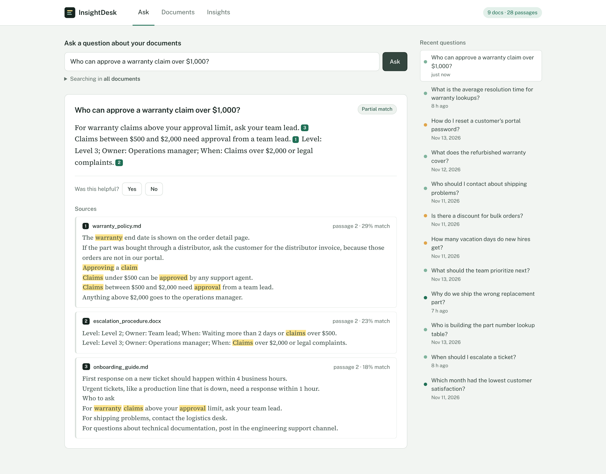
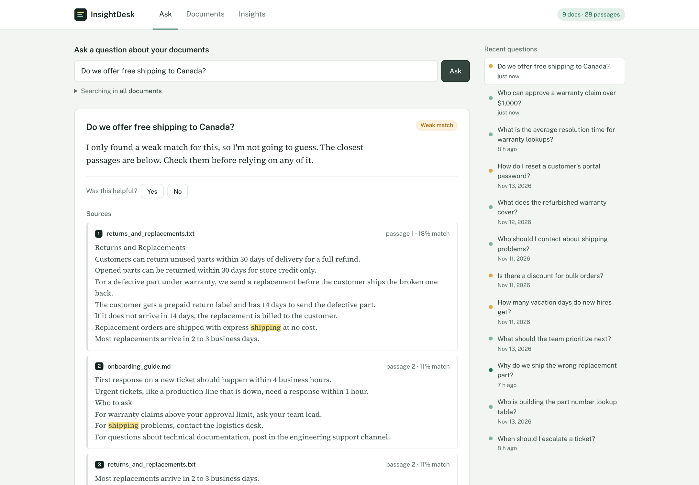
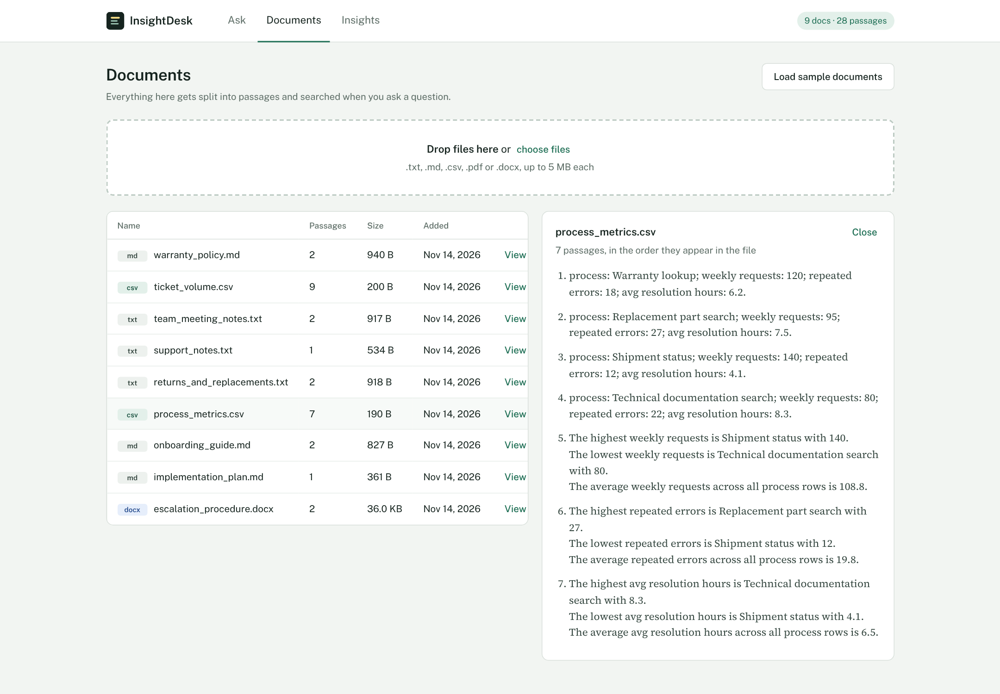
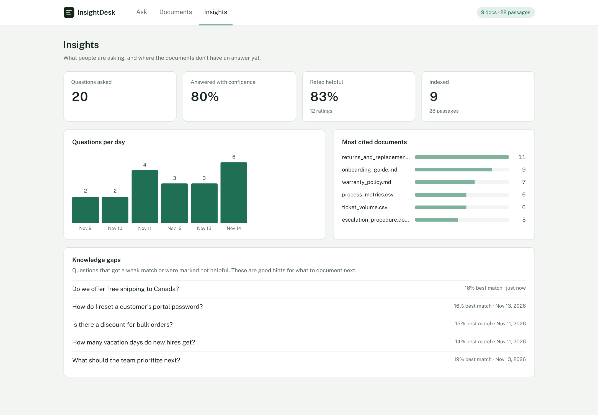
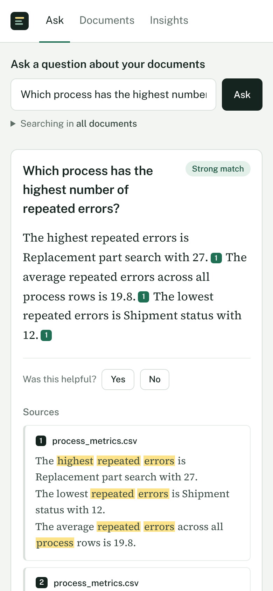

# InsightDesk

[](https://github.com/m2ebadian/InsightDesk/actions/workflows/ci.yml)


InsightDesk is a small internal-knowledge assistant. You upload your team's notes, docs and spreadsheets, ask questions in plain English, and get back an answer with the exact passages it came from.

It doesn't use a paid LLM API. Everything runs locally: documents get split into passages, indexed with TF-IDF, and the answer is built from the best-matching sentences, each one tagged with its source. If it can't find a good match, it says so instead of making something up.



## Why I built it

A lot of teams have information spread across spreadsheets, notes, procedures and project docs, and finding the right answer means digging through all of them. I wanted a lightweight way to search that information where every answer points back to the original source, so you can check it instead of just trusting it.

## Features

- Upload `.txt`, `.md`, `.csv`, `.pdf` and `.docx` files (drag and drop works too)
- Ask questions and get an answer built from real sentences in your documents, with numbered citations you can click to jump to the source
- Matching words are highlighted in each source passage
- Confidence label on every answer (strong, partial or weak match). Weak matches don't get an answer, just the closest passages
- Search all documents or only the ones you pick
- Spreadsheets are handled row by row, plus a summary of each numeric column, so questions like "which process has the most errors?" work
- Question history and "was this helpful?" feedback
- Insights page with questions per day, most cited documents, and a list of **knowledge gaps**: questions that got a weak match or were marked not helpful, so you know what's missing from the docs
- Documents and history are saved in SQLite, so nothing is lost on restart
- Runs with Docker Compose, has tests and CI

## Screenshots

| Weak match (it doesn't guess) | Documents |
| --- | --- |
|  |  |

| Insights | Mobile |
| --- | --- |
|  |  |

## How it works

1. **Parsing:** each file is turned into text. PDFs use `pypdf`, Word files use `python-docx`. CSV rows become passages like `process: Warranty lookup; repeated errors: 18`, and each numeric column also gets a summary ("The highest repeated errors is Replacement part search with 27").
2. **Chunking:** text is split into passages of about 100 words, made of whole sentences, with one sentence of overlap between passages.
3. **Indexing:** all passages go into a TF-IDF model (scikit-learn). Words are stemmed with NLTK's Porter stemmer, so "approve", "approved" and "approval" count as the same word.
4. **Searching:** the question is compared to every passage with cosine similarity, and the top 3 become the sources.
5. **Answering:** every sentence in those sources is scored against the question, and the best 1 to 3 sentences become the answer, each tagged with its source number. Headings and table labels are skipped.
6. **Confidence:** this comes from the best match score plus how much of the question the sources actually cover. Rare words count more. For example, "Is there a discount for bulk orders?" only matches the word "orders", so it's marked as a weak match.

## Tech Stack

- **Backend:** Python, FastAPI, scikit-learn, NLTK, SQLite, pypdf, python-docx
- **Frontend:** React, TypeScript, Vite, React Router
- **Tooling:** pytest, Ruff, oxlint, Docker, GitHub Actions
- **Concepts shown:** document ingestion, retrieval, grounded answers with citations, REST APIs, testing, containers

## Quick Start

### With Docker

```bash
git clone https://github.com/m2ebadian/InsightDesk.git
cd InsightDesk
docker compose up --build
```

Then open http://localhost:3000, go to **Documents** and click **Load sample documents**. The API docs are at http://localhost:8000/docs.

### Without Docker

Backend:

```bash
cd insightdesk-agent/backend
python -m venv .venv
source .venv/bin/activate   # Windows: .venv\Scripts\activate
pip install -r requirements.txt
uvicorn app.main:app --reload
```

Frontend (in a second terminal):

```bash
cd insightdesk-agent/frontend
npm install
npm run dev
```

The frontend runs at http://localhost:5173 and forwards `/api` requests to the backend on port 8000.

To fill the history and Insights page with some example questions:

```bash
pip install httpx
python insightdesk-agent/scripts/demo_data.py
```

## API Endpoints

| Method | Endpoint | What it does |
|---|---|---|
| GET | `/health` | API status and how many documents/passages are indexed |
| GET | `/documents` | List uploaded documents |
| POST | `/documents` | Upload one or more files (multipart, field name `files`) |
| POST | `/documents/sample` | Load the files in `sample_docs/` |
| GET | `/documents/{id}` | One document and all of its passages |
| DELETE | `/documents/{id}` | Remove a document from the index |
| POST | `/ask` | Ask a question: `{"question": "...", "top_k": 3, "document_ids": [1, 2]}` |
| GET | `/questions` | Recent questions and their answers |
| POST | `/questions/{id}/feedback` | Mark an answer as helpful or not: `{"helpful": true}` |
| GET | `/insights` | Stats for the Insights page |

## Example Questions

After loading the sample docs, try:

- `What issues are slowing down the support process?`
- `Which process has the highest number of repeated errors?`
- `Who can approve a warranty claim over $1,000?`
- `What happens if the customer doesn't send the broken part back?`
- `When should I escalate a ticket?`
- `Is there a discount for bulk orders?` (not in the docs, so you'll get a weak match)

## Configuration

| Variable | Default | What it does |
|---|---|---|
| `DATA_DIR` | `backend/data` | Where the SQLite database is stored |
| `MAX_UPLOAD_MB` | `5` | Max size per uploaded file |
| `CORS_ORIGINS` | `http://localhost:5173` | Only needed if the frontend is hosted on a different domain than the API |

## Project Stats

| | |
|---|---|
| Backend tests | 28 tests, 98% coverage |
| Backend code | ~900 lines of Python, plus ~340 lines of tests |
| Frontend code | ~1,750 lines of TypeScript/CSS (86 kB gzipped JS) |
| Supported file types | 5 (`.txt`, `.md`, `.csv`, `.pdf`, `.docx`) |
| Sample documents | 9, about a made-up support team |

Rough speed on a 2 vCPU Linux VM:

| Index size | Rebuilding the index | Answering a question |
|---|---|---|
| 1,000 passages | 0.7 s | ~5 ms |
| 5,000 passages | 4.6 s | ~29 ms |

The index is rebuilt after every upload or delete, which is fine at this size but would be the first thing to change for a big document collection.

## Running Tests

```bash
cd insightdesk-agent/backend
pip install -r requirements-dev.txt
pytest --cov=app
ruff check . ../scripts

cd ../frontend
npm run lint && npm run build
```

GitHub Actions runs these on every push and also builds the Docker images.

## Project Structure

```
insightdesk-agent/
  backend/
    app/
      main.py          API routes
      parsing.py       reading files and splitting them into passages
      retriever.py     TF-IDF search, answer building, confidence
      db.py            SQLite tables and queries
      schemas.py       request/response models
      config.py        settings from environment variables
    tests/
  frontend/
    src/
      pages/           Ask, Documents, Insights
      components/      header, highlighted text, confidence badge
      api.ts           API client
  sample_docs/         example notes, policies and spreadsheets
  scripts/             demo data script
docker-compose.yml
```

## Limitations

- It's keyword based, so it won't connect words that mean the same thing but look different ("car" vs "vehicle").
- Answers are copied sentences, not rewritten summaries, so they can read a little choppy.
- Scanned PDFs (images of text) won't work, since there's no OCR.
- There's no login, so anyone who can reach it can see and delete documents.

## Future Improvements

- Use sentence embeddings for search so similar meanings match, not just similar words
- Optional OpenAI/Azure OpenAI step to rewrite the extracted sentences into a smoother answer (still citing sources)
- Authentication and per-team document spaces
- Store everything in PostgreSQL for bigger deployments
- Update the index incrementally instead of rebuilding it every time
